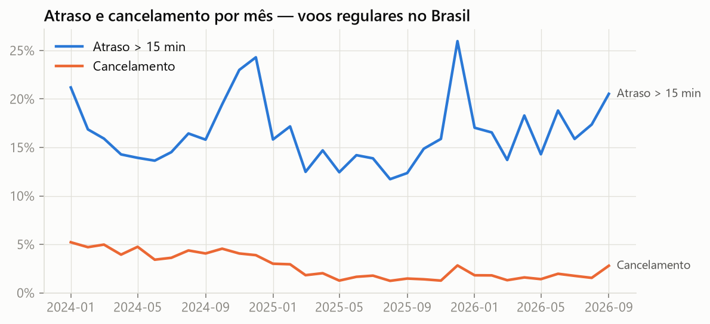
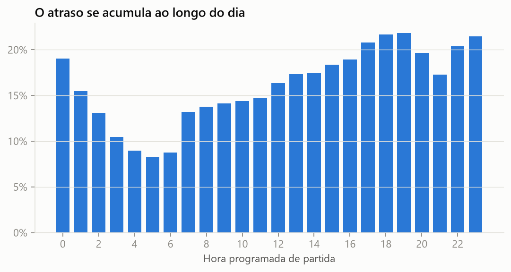
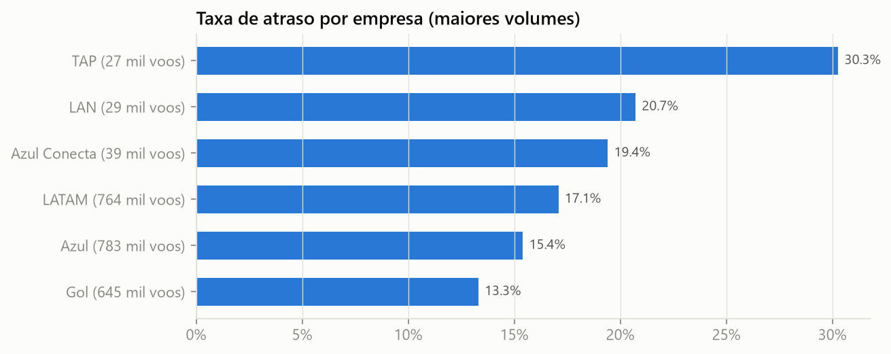
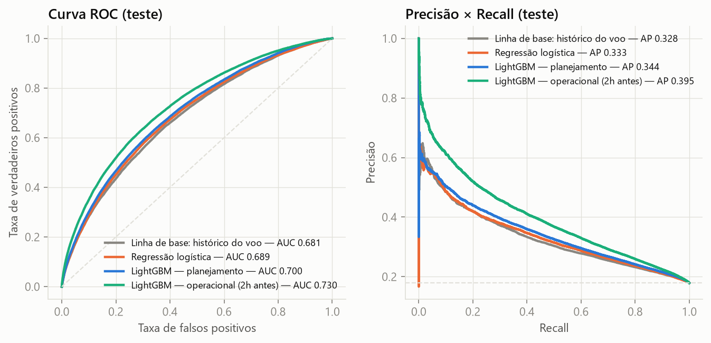
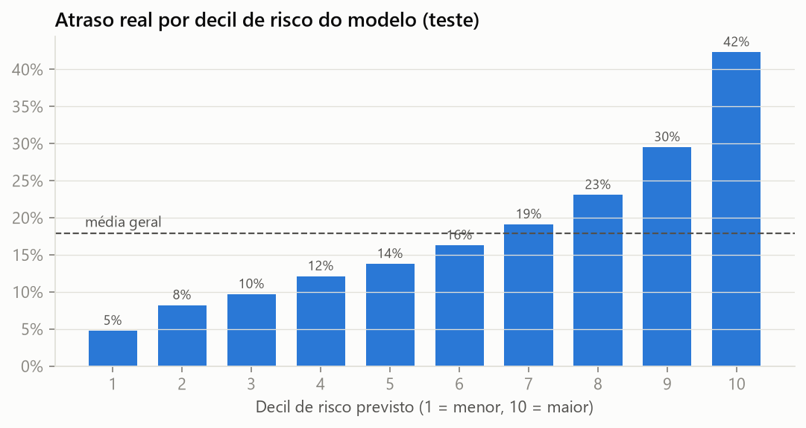
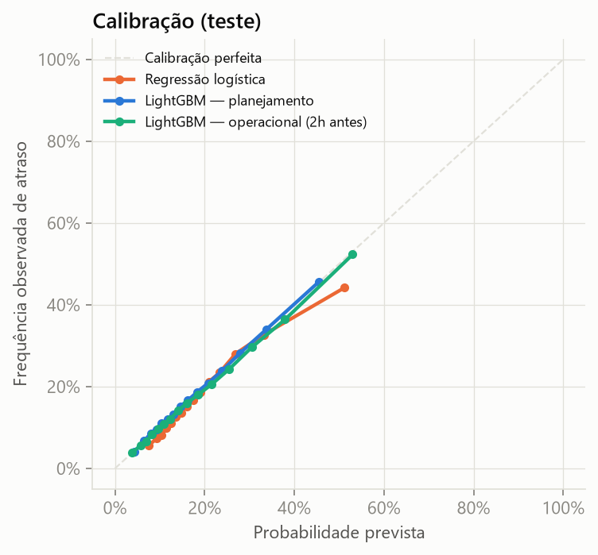
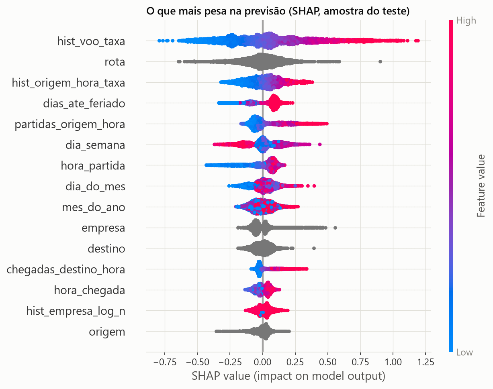

# ✈️ Previsão de atrasos de voos no Brasil

[](https://github.com/YUCAVALCANTE/atrasos-voos-brasil/actions/workflows/ci.yml)


Modelo ponta a ponta que estima a **probabilidade de um voo regular chegar com mais de 15 minutos de atraso**, treinado com **2,5 milhões de voos reais** dos microdados [VRA — Voo Regular Ativo](https://www.gov.br/anac/pt-br/assuntos/dados-e-estatisticas/historico-de-voos) da ANAC (jan/2024 a set/2026).

O projeto cobre o ciclo inteiro: coleta automatizada → limpeza → engenharia de atributos sem vazamento temporal → comparação com linhas de base → explicabilidade (SHAP) → API REST em Docker com CI.

## Resumo dos resultados

Avaliação no **período de teste (jul–set/2026)**, que o modelo nunca viu durante o treino nem a escolha de hiperparâmetros:

| Modelo | ROC-AUC | PR-AUC | Precisão nos 10% de maior risco | Lift top 10% | Brier ↓ |
|---|---|---|---|---|---|
| Linha de base: histórico do voo | 0,681 | 0,328 | 40,5% | 2,26× | 0,138 |
| Regressão logística | 0,689 | 0,333 | 40,6% | 2,27× | 0,137 |
| **LightGBM — planejamento (véspera)** | **0,700** | **0,344** | **42,3%** | **2,37×** | **0,135** |
| **LightGBM — operacional (2h antes)** | **0,730** | **0,395** | **47,7%** | **2,67×** | **0,130** |

Taxa base de atraso no teste: 17,9%.

📊 **[Dashboard interativo](https://claude.ai/artifact/1tUwpod63gd3NEGtehFPF9)**: explore atrasos por empresa, aeroporto e período, com o desempenho do modelo.

**Principais conclusões**

1. **Atraso é um fenômeno que se propaga ao longo do dia.** Saber como a operação está *agora* (atraso médio da empresa e do aeroporto nas últimas 3 h) é o que mais melhora a previsão: o AUC sobe de 0,700 para 0,730 e a precisão no topo do ranking sobe de 42% para 48%.
2. **O histórico do próprio voo é uma linha de base difícil de bater.** Ele sozinho chega a 0,681 de AUC. O LightGBM soma calendário, congestionamento e interações e chega a 0,700. O ganho é modesto e eu reporto como ele é: com a malha programada como única informação, boa parte do atraso continua imprevisível (clima, manutenção e controle de tráfego não estão nos dados).
3. **Mesmo assim, o ranking é útil na prática.** Os 10% de voos de maior risco atrasam **42%** das vezes, contra **4,8%** nos 10% de menor risco: uma diferença de quase 9×.
4. **As probabilidades são bem calibradas.** Quando o modelo diz 30%, atrasam cerca de 30%. Por isso dá para usá-las direto em decisões de custo (ex.: vale reforçar a equipe de solo se P(atraso) × custo > custo do reforço).

---

## 1. O problema

Atraso é caro para todos: a companhia paga tripulação e conexões perdidas, o aeroporto reorganiza pátio e portões, e o passageiro perde compromissos. Um modelo de risco permite **priorizar atenção** — reforçar equipes de solo, avisar passageiros em conexão, ajustar escalas — nos voos com maior chance de atrasar.

Avalio dois momentos de decisão:

| Cenário | Quando a previsão é feita | O que o modelo sabe |
|---|---|---|
| **Planejamento** | na véspera / ao montar a escala | malha programada, calendário, histórico de meses anteriores |
| **Operacional** | 2 horas antes da partida | tudo acima **+** como a operação está rodando nas últimas 3 horas (atrasos no aeroporto de origem, de destino e na rede da empresa) |

## 2. Dados

* **Fonte:** arquivos mensais do VRA no [portal de dados abertos da ANAC](https://sistemas.anac.gov.br/dadosabertos/), baixados por `atrasos.download`.
* **Volume:** 2.571.358 voos programados, 2,8% cancelados; 2.474.696 voos realizados com horários válidos.
* **Alvo:** `atrasado = chegada_real − chegada_prevista > 15 min` (definição usada pela ANAC). Taxa base: **16,5%**.
* **Limpeza:** remoção de duplicatas de republicação, atrasos impossíveis (< −2 h ou > 24 h, erros de fuso/registro) e tempos de bloco inválidos.

<p align="center">
  
  
</p>
<p align="center"></p>

## 3. Metodologia

### Validação temporal (sem embaralhar)

```
2024-01 ─ 2024-03 │ 2024-04 ───────────── 2025-12 │ 2026-01 ─ 2026-06 │ 2026-07 ─ 2026-09
   só histórico   │        treino (1,58 M)        │ validação (439 mil)│  teste (232 mil)
```

Hiperparâmetros e limiar de decisão são escolhidos **apenas na validação**. O modelo final é re-treinado em treino + validação e avaliado **uma única vez** no teste — que simula o uso real: prever meses que ainda não aconteceram.

### Atributos — e como evitei vazamento

| Grupo | Exemplos | Cuidado com vazamento |
|---|---|---|
| Calendário | hora programada, dia da semana, mês, distância até feriado | só horários **previstos** |
| Malha | rota, empresa, tempo de bloco previsto | — |
| Congestionamento | voos **programados** no mesmo aeroporto e hora | malha é conhecida com antecedência |
| Histórico "as-of" | taxa de atraso por empresa, rota, aeroporto, número do voo, aeroporto×hora | calculada **só com os 3 meses anteriores** ao mês do voo; suavização bayesiana para rotas raras |
| Operacional *(só no cenário operacional)* | atraso médio das partidas na origem / chegadas no destino / rede da empresa nas últimas 3 h | só eventos com horário real **anterior** ao instante da previsão |

Os pontos críticos têm testes automatizados ([`tests/`](tests)): um voo nunca enxerga o próprio mês no histórico, e o contexto operacional ignora qualquer evento posterior ao instante da previsão.

### Modelos comparados

1. **Linha de base — histórico do voo:** usa diretamente a taxa de atraso suavizada daquele número de voo nos 3 meses anteriores. É o "palpite de quem conhece a operação".
2. **Regressão logística:** atributos numéricos padronizados + one-hot das categóricas de baixa cardinalidade.
3. **LightGBM (planejamento):** gradient boosting com categóricas nativas (rotas, aeroportos, empresas).
4. **LightGBM (operacional):** o mesmo modelo + atributos de contexto operacional.

Busca de hiperparâmetros do LightGBM (AUC na validação):

| Configuração | AUC |
|---|---|
| 127 folhas, mín. 200 por folha, lr 0,05 | 0,6809 |
| 63 folhas, mín. 1000 por folha, lr 0,03 | 0,6829 |
| 31 folhas, mín. 2000 por folha, categóricas regularizadas | 0,6841 |
| **63 folhas, mín. 1000 por folha, categóricas regularizadas (escolhida)** | **0,6854** |

Árvores menores e mais regularizadas generalizam melhor para meses futuros, mas o ganho é pequeno: o limite está na informação disponível, não no ajuste fino.

Experimentos registrados no **MLflow** (`mlflow ui --backend-store-uri sqlite:///mlflow.db`).

## 4. Resultados

<p align="center"></p>

### O modelo é útil para priorizar?

Ordenando os voos do teste pelo risco previsto:

<p align="center"></p>

A taxa real de atraso cresce de forma monotônica com o risco previsto: **4,8%** no decil de menor risco contra **42,3%** no de maior risco. Os voos do último decil chegam, em média, **19 minutos** depois do previsto, enquanto os do primeiro decil chegam 6 minutos *antes*.

### As probabilidades são confiáveis?

<p align="center"></p>

As curvas acompanham a diagonal: em cada decil, a probabilidade média prevista fica a menos de 1 ponto percentual da taxa observada (ex.: 29,2% previsto contra 29,5% real no 9º decil). O LightGBM foi treinado com perda logarítmica e não precisou de recalibração.

### O que o modelo aprendeu (SHAP)

<p align="center"></p>

* **Histórico do voo** (`hist_voo_taxa`) é o fator mais forte: voos que atrasaram nos últimos meses tendem a seguir atrasando.
* **Congestionamento** (`partidas_origem_hora`, `chegadas_destino_hora`): mais voos programados no mesmo aeroporto e hora aumentam o risco.
* **Hora do dia**: voos do início da manhã têm risco bem menor; o atraso se acumula com o passar das horas.
* **Fim de semana** (`dia_semana` alto) reduz o risco, e a **proximidade de feriados** muda o padrão de demanda.
* No modelo operacional, o **atraso atual da rede da empresa** passa a ser o terceiro atributo mais importante.

## 5. Limitações e próximos passos

* **Sem clima.** Dados meteorológicos (METAR/INMET) por aeroporto e hora são o próximo passo natural e devem trazer o maior ganho.
* **Sem a aeronave.** O VRA não informa a matrícula, então não dá para seguir o atraso do voo anterior do mesmo avião (o *rotation delay*, principal causa de atraso em hubs).
* **Mudança no tempo.** O AUC na validação (0,685) e no teste (0,700) difere um pouco, porque a mistura de rotas e o nível de atraso mudam de um trimestre para outro. Em produção, o modelo deve ser re-treinado todo mês, quando a ANAC publica novos dados.
* **Congestionamento na API.** A API recebe um voo isolado, então usa a média histórica de voos programados por aeroporto, dia da semana e hora, em vez da malha real do dia.

## 6. API

```bash
uvicorn atrasos.api:app --reload      # ou: docker build -t atrasos-api . && docker run -p 8000:8000 atrasos-api
```

```bash
curl -X POST localhost:8000/prever -H "Content-Type: application/json" -d '[{
  "empresa": "GLO", "numero_voo": "1234", "origem": "SBGR", "destino": "SBRJ",
  "partida_prevista": "2026-11-20T18:30:00", "chegada_prevista": "2026-11-20T19:35:00"
}]'
```

```json
[
  {
    "probabilidade_atraso": 0.1426,
    "alerta": false,
    "limiar": 0.15,
    "principais_fatores": [
      {"atributo": "mes_do_ano", "valor": 11, "contribuicao": 0.4094},
      {"atributo": "dias_ate_feriado", "valor": 0, "contribuicao": -0.3863},
      {"atributo": "rota", "valor": "SBGR-SBRJ", "contribuicao": -0.2979}
    ]
  }
]
```

No exemplo, novembro puxa o risco para cima, mas 20/11 é feriado (Dia da Consciência Negra) e a ponte aérea SBGR–SBRJ tem bom histórico, o que puxa o risco para baixo.

A resposta traz a probabilidade, um alerta (limiar escolhido na validação) e os **5 fatores que mais pesaram** naquele voo (contribuições SHAP em log-odds) — a previsão vem explicada. Documentação interativa em `http://localhost:8000/docs`.

A API serve o modelo de **planejamento**: ela recebe um voo isolado, então o congestionamento usa a média histórica de voos programados no aeroporto naquele dia da semana e hora.

## 7. Como reproduzir

```bash
git clone https://github.com/YUCAVALCANTE/atrasos-voos-brasil && cd atrasos-voos-brasil
python -m venv .venv && source .venv/bin/activate    # Windows: .venv\Scripts\activate
pip install -e ".[treino,dev]"

make pipeline     # baixa ~400 MB da ANAC, limpa, gera atributos, treina e gera as figuras
make testes       # ruff + pytest
```

Sem `make` (Windows): rode em sequência `python -m atrasos.download`, `atrasos.limpeza`, `atrasos.preparar`, `atrasos.treino`, `atrasos.relatorio`.

## Estrutura

```
src/atrasos/
├── download.py     # coleta dos CSVs mensais da ANAC (com retentativas)
├── limpeza.py      # padronização, cálculo de atraso, filtros de qualidade
├── atributos.py    # calendário, congestionamento, histórico as-of, contexto operacional
├── preparar.py     # monta a tabela de modelagem e a divisão temporal
├── treino.py       # linhas de base, LightGBM, MLflow, empacotamento do modelo
├── metricas.py     # ROC/PR-AUC, Brier, precisão e lift no top 10%
├── relatorio.py    # figuras do README
├── dashboard_dados.py  # agrega os dados do dashboard interativo
├── predicao.py     # inferência + explicação SHAP por voo
└── api.py          # FastAPI
tests/              # vazamento temporal, suavização, limpeza, API
dashboard/          # página do dashboard interativo (d3)
```

---

Autor: **Yury Cavalcante** · [LinkedIn](https://www.linkedin.com/in/yucavalcante/) · Dados: ANAC (dados abertos).
